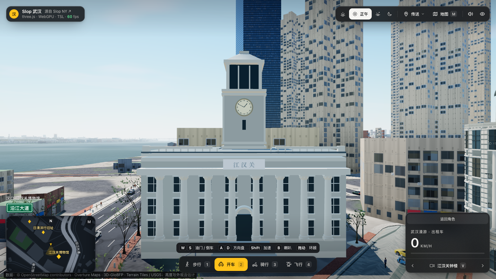
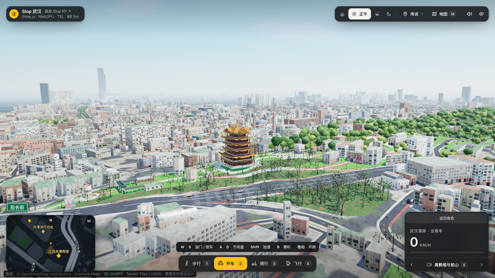
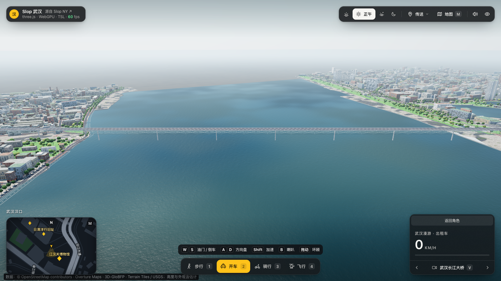

# Slop 武汉 · Wuhan Roam

在浏览器里逛武汉。沿江汉路走到江汉关，开着出租车穿过长江大桥，骑车看看汉口老街，或者驾驶直升机，俯瞰两江三镇。

基于真实地理数据生成的 1:1 武汉核心区漫游，源自 [mrdoob 的 Slop New York](https://github.com/mrdoob/slop-newyork)，使用 [three.js](https://threejs.org/)、WebGPU 和 TSL。

A browser-based Wuhan city simulation, inspired by Slop New York. Walk, drive a taxi, ride a scooter or fly a helicopter around the Yangtze and Han rivers.

**[在线体验武汉](https://lightyearzh.github.io/slop-wuhan/)** · **[原作体验](https://mrdoob.github.io/slop-newyork/)** · **[其他 Slop 城市](https://github.com/zz85/slop-cities)** · **[本地运行](#本地运行)** · **[更新记录](docs/CHANGELOG.md)**

> 当前版本 **0.10.0**，出租车改为全图随机接送：起终点按实际可达道路生成，支持跨江和长途订单、乘客上下车及虚拟车费结算。建议使用支持 WebGPU 的桌面浏览器，首次进入需要加载地图并编译着色器。当前仍是城市漫游原型，尚未加入完整剧情和经营系统。



## 可以逛些什么

地图覆盖武汉市中心约 **8 × 6 公里**的矩形区域，包含两江交汇，以及汉口、武昌、汉阳的部分街区。地理位置和水平距离按真实尺度保留，没有把各个景点挪到一起。

- **两江三镇**：长江、汉江、汉口江岸，以及龟山、蛇山的起伏。
- **代表地标**：江汉关、黄鹤楼、龟山电视塔、晴川阁、红楼，以及绿地中心等滨江建筑；专用外观和普通建筑体量分别制作，细节仍有简化。
- **街区与历史建筑**：江汉路、沿江大道和22栋有来源身份记录的历史建筑立面，包括柱廊、拱窗、阳台、檐口与转角圆顶。
- **跨江通行**：武汉长江大桥、晴川桥、江汉桥，以及连接汉口与武昌的武汉长江隧道两条单向主洞。
- **自由漫游**：步行、驾驶出租车、骑行、飞行；小地图、路名与地点搜索、传送、景点相机，以及黄昏、正午、蓝调和夜间四种时段。
- **出租车接送**：汽车模式主动开始接单，在汉口、武昌、汉阳的可达道路上随机接送乘客，行程不限于短途；地图与路面导航、停车上下客、按实际行程结算。详见[玩法与范围](docs/TAXI.md)。
- **程序化城市**：23,000多栋普通建筑、车辆与行人、树木、街灯和招牌。大部分建筑依据轮廓和属性自动生成，地标再单独细化。

第一次玩，可以试试：

1. **江汉关出发**：步行看钟楼和沿江历史建筑，再进入江汉路。
2. **开车过江**：选择汽车，前往隧道入口，沿道路驶向另一岸；也可以经过汉阳，从长江大桥去武昌。
3. **飞起来看三镇**：切换飞行，升空看两江交汇、大桥、电视塔和黄鹤楼；也可以使用景点相机观察全景。

## 实机截图

以下均为0.8.5本地运行截图，展示当前程序化模型效果。

### 黄鹤楼与蛇山



### 武汉长江大桥



## 怎么操作

优先使用支持 WebGPU 的桌面浏览器，例如新版 Chrome 或 Edge，通过键盘和鼠标游玩。

| 操作 | 按键或入口 |
| --- | --- |
| 步行 / 开车 / 骑行 / 飞行 | `1` / `2` / `3` / `4`，或底部按钮 |
| 前进 / 后退，飞行时俯仰 | `W` / `S` |
| 转向，飞行时偏航 | `A` / `D` |
| 加速 | 按住 `Shift` |
| 飞行上升 / 下降 | `E` / `Q`，也支持 `Space` / `C` |
| 环顾 | 鼠标拖动 |
| 切换相机 | `V`；观景时可点“返回角色” |
| 打开地图并搜索 | `M`，或右上角“地图” |
| 前往代表地点 | 右上角“传送”，保留当前移动方式 |
| 切换时段 | 右上角时段按钮 |
| 声音开关 / 隐藏界面 | `N` / `H` |
| 开始接单 / 接受订单 / 再接一单 | 汽车模式按 `T`，或左上任务按钮；可随时取消 |

## 本地运行

需要 **Node.js 22.12+**。生成好的武汉数据和图形依赖已包含在仓库中，首次游玩不需要下载原始地图，也不需要配置 AI 接口。

```sh
git clone https://github.com/LightYearZh/slop-wuhan.git
cd slop-wuhan
npm ci
npm run dev
```

打开 [http://127.0.0.1:4799/](http://127.0.0.1:4799/)。

构建静态站点：

```sh
npm run build
npm run preview
```

打开 [http://127.0.0.1:4187/](http://127.0.0.1:4187/)。部署时使用生成的 `dist/`，不能直接把未经构建的源码入口当作静态发行包。

0.8.5采用独立压缩地图包：地图约 **4.34 MB**，本机Chrome冷缓存首次资源正文合计约 **4.98 MB**（含HTML、脚本、样式，服务器启用HTTP压缩）。这不是整个仓库或全部部署文件的大小，也不代表所有设备都能瞬间进入；场景生成和着色器编译仍需要时间。详见[加载优化与实测](docs/LOADING_OPTIMIZATION.md)。

## 地图、数据和还原程度

当前范围为东西约8.06公里、南北约6.01公里，外框约48.41平方公里，**包含江面，不是整个武汉**。普通源建筑23,461栋，4,078段源道路转为9,573条路口间连接；渲染部件数与源建筑数分别统计。

| 数据 | 用途 |
| --- | --- |
| [OpenStreetMap](https://www.openstreetmap.org/copyright) | 道路、水系、部分建筑、桥隧、地名和POI |
| [Overture Maps](https://docs.overturemaps.org/guides/buildings/) | 补充建筑轮廓，与OSM逐栋去重 |
| [3D-GloBFP](https://doi.org/10.5194/essd-16-5357-2024) | 补充2020年参考年份的遥感估算高度 |
| [Terrain Tiles / USGS](https://registry.opendata.aws/terrain-tiles/) | 龟山、蛇山的地形起伏 |

“一比一”指水平地理位置与距离，并不表示每栋楼、每个门窗都准确复原：

- 建筑高度分别来自地图记录、层数换算、遥感模型、公开资料与视觉估算。高楼仍可能被低估。
- 通用立面、地标细部、树木和街具包含程序化表现；街区风貌重建不等于建筑历史身份认定，也不是逐街实景扫描。
- 山体、桥面、隧道深度与坡道仍含估计，其他低地尚未完整接入精细DEM。
- 当前整体生成核心区场景，再按位置和距离裁剪显示；尚不是城市数据按需流式下载。低配置和移动设备体验仍需分别实测。

完整来源、固定版本与许可见[数据说明](public/data/DATA-LICENSE.md)、[区域扩展记录](docs/CORE_EXPANSION.md)和[运行数据审计](public/data/runtime-audit.json)。

## 开发与改编

欢迎基于这个项目继续试验，或参考流程制作自己的城市。更换城市数据后，仍需要逐项处理道路、水岸、桥隧、地形和地标，不能只修改城市名称。

- [开发、数据重建与检查](docs/DEVELOPMENT.md)
- [发布前敏感信息检查](SECURITY.md)
- [可复用城市工作流程](docs/CITY_WORKFLOW.md)
- [项目工作记录](docs/PROJECT_HISTORY.md)
- [首个公开体验版与发布入口](docs/PUBLISHING.md)
- [版本更新记录](docs/CHANGELOG.md)

报告问题时，请尽量附上地点或路口、移动方式和截图，方便定位。

## 来源与致谢

感谢 **[mrdoob / Slop New York](https://github.com/mrdoob/slop-newyork)** 开源这套城市模拟。武汉版沿用原作的自由探索方向，并复用这一系列项目的成果。

- **[Slop Taipei](https://github.com/shwang1979/slop-taipei)**：当前运行系统的重要代码基础，包含渲染、角色、车辆、交通、相机、地图和音效；武汉版替换城市数据、简体中文界面、地标和场景规则。
- **[Shanghai Roam](https://github.com/YakirLove/ShangHai)**：国内OSM数据导入、城市适配与隧道处理的参考，也是武汉早期版本的基础。
- **[London Loop](https://github.com/nelsonchris1/london-loop)**：出租车道路导航、停靠与乘客流程的参考；武汉版按自己的路网实现轻量接送，未移植其完整账户、评分与经营系统。
- **[Slop Cities](https://github.com/zz85/slop-cities)**：收集各地的城市衍生版本。

当前基线、上游版本及选择性移植记录见[UPSTREAM.json](docs/UPSTREAM.json)。原始代码许可保留于[纽约原作副本](vendor/slop-newyork/LICENSE)、[台北版本许可](docs/upstream/TAIPEI-LICENSE)和各依赖目录。

应用代码采用 [MIT License](LICENSE)。地理数据保留各自许可：OSM与整合地理数据库按ODbL 1.0提供；3D-GloBFP按CC BY 4.0署名；高程保留Terrain Tiles／USGS归属。代码开源不改变第三方数据条款，详见[数据许可](public/data/DATA-LICENSE.md)。
