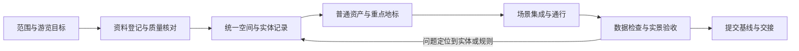

# 可复用的城市场景生产流程

整理日期：2026-10-29。依据武汉基础版`508d23e`的实际工作。下文区分“已经实现的工具”和“建议迁移的做法”，不把武汉仓库称为通用城市生成器。

## 1. 一条主线、四类产物

目标是从可追溯资料生产可探索场景，并能在后续换模型、换范围、换表现方案时持续复用。



| 产物 | 保存的内容 | 复用价值 |
| --- | --- | --- |
| 资料与证据 | 原始文件、出处、版本、范围、时间、核验状态、支持哪些断言 | 能纠正错误，避免新模型覆盖旧证据 |
| 世界空间数据 | 米制框架、稳定ID、道路/河岸/占地/孔洞/高度/通行 | 不依赖某个Three.js对象或某个模型 |
| 资产与表现规则 | 模型、构件、材质、比例/原点转换、生成参数、资产绑定 | 能替换、重组；普通与重点建筑分开生产 |
| 验收与版本 | 数据审计、固定机位、实际路线、问题清单、提交及重建说明 | 让“做完”有可复查的边界 |

## 2. 每轮迭代的标准步骤

| 步骤 | 必做工作 | 输出和通过条件 |
| --- | --- | --- |
| ① 明确本轮范围 | 指定区域、时代/日期、主要体验、代表地点、暂缓内容；写清1:1还是假设布局 | [场景简报模板](templates/SCENE_BRIEF.md)；知道从哪里走到哪里、看什么 |
| ② 保存可回退基线 | 记录分支、提交、数据版本和依赖；识别已有未提交改动 | 变更前可重现，不把其他任务工作混进本轮 |
| ③ 调查并验证参考 | 锁定参考版本；看真正的运行入口和数据字段；记录已读、已跑和未测范围 | 复用矩阵；不因文件存在就认定已启用 |
| ④ 登记资料与缺口 | 核对覆盖范围、日期、坐标、单位、字段、获取方式、授权记录和缺失项 | [证据与资产模板](templates/EVIDENCE_AND_ASSETS.md)；可定位原始文件和支持的属性 |
| ⑤ 统一空间数据 | 统一单位、轴向、原点、稳定ID；处理内外环、分部体量、道路层级和显式开口 | 可读源记录及二维检查图；错误可回到实体 |
| ⑥ 融合与推断 | 按几何和身份匹配；明确保留、覆盖、拒绝和歧义原因；固定种子 | 保留前值与来源，不用“最近中心点”强配，不把推断写成事实 |
| ⑦ 生产资产与构件 | 普通重复建筑用规则或少量资产变体；地标按专门资料处理；统一尺度、材质和入口 | 轮廓、正面、侧后方和近景达标；不靠数量掩盖类型错误 |
| ⑧ 接入运行系统 | 数据适配、实例生成、场景挂接、剔除、地图/到达点逐项检查 | “数据有→生成了→加入场景→可见→碰撞相符”都有证据 |
| ⑨ 自动与空间检查 | 数据引用、有限数值、孔洞、体量边界、覆盖范围、相交、通行连续性；执行受影响测试和构建 | 规则失败先定位修复；零冲突只说明该规则范围通过 |
| ⑩ 浏览器真实验收 | 普通网址冷启动；走/开过关键路线；固定光照和镜头看近景、俯视、侧后方；检查目标屏幕 | 图像、运行错误、模式、碰撞和到达点一起检查；自动路线标明方法 |
| ⑪ 一批修正并确认 | 根据同一批验收结果集中修正，再按相同条件确认；只因新失败扩大检查 | 问题结论与剩余边界清楚，不无限细调无关区域 |
| ⑫ 提交和交还 | 提交源码、配置、数据及报告，更新数量口径和重建步骤，恢复正常游玩 | [迭代记录模板](templates/ITERATION_RECORD.md)；无遗留固定镜头、隐藏UI或测试输入 |

## 3. 数据与表现的约定

### 坐标与身份

固定原点，米为单位，轴向有明文约定。扩区不顺便移动旧城；更换模型不更换实体ID。资料ID、世界实体ID、资产ID、渲染批次ID分开，保留对应关系。

武汉有现代地理数据，使用WGS84转局部米制。历史城市没有可靠地理定位时，可以用局部假设坐标；不能为了接入武汉脚本而伪造经纬度精度。

### 属性级证据

一栋建筑的“地点、占地、总高、层数、年代、用途、屋顶、材质”可能来自不同资料。每个关键属性记录来源、参考年代、证据状态和推定方法，不能给整栋楼贴一个“真实”标签就算完成。

武汉使用的高度融合是有适用范围的规则：有明确依据的资料校准、来源高度/层数、严格匹配的模型估计、最后才是标记清楚的显示推断。遇到冲突保留改前值和采用理由；官方资料里的海拔不能直接当建筑净高。

### 源层和运行层

武汉的源层为`public/data/city.json`及`data/source/`资料，运行层由`tools/build-runtime.py`转换到`js/runtime/wuhan-geodata.js`。显示层可以估计立面和细节，不反写原始资料。生成文件不应被当作人工长期编辑入口。

这套“源记录→适配→表现”的结构可以沿用；OSM专用字段、武汉原点、现代用途分类和台北特有构件不能原样套给宋代城市。

## 4. 普通建筑、特色建筑和地标如何分工

| 层次 | 制作方式 | 验收重点 |
| --- | --- | --- |
| 普通重复建筑 | 少量合格模型或可复用规则，固定种子生成受控变体 | 用途、尺度、密度、重复感、近景侧后方 |
| 地区特色建筑 | 按类型组装门窗、檐口、屋顶、墙面、首层和入口 | 类型正确，有地区差异，不把通用模板当专用复原 |
| 关键地标 | 身份绑定、专项资料、专用体量和重要构件 | 轮廓、体量、标志部位、定位与游览关系 |
| 场景生活物件 | 使用合格资产，按通行和空间规则放置 | 占地、可见性、碰撞、生活逻辑和年代适配 |

优先修正能改变空间辨识的轮廓、屋顶、开口和街面，再堆小装饰。先通过几个有代表性的实例，再抽出共享构件；不预先建设包罗万象的生成器。

## 5. 显示、碰撞、通行必须一起处理

| 场景要素 | 同一份空间约定应驱动什么 | 武汉留下的反例 |
| --- | --- | --- |
| 地形 | 实际渲染三角面、接触高度、道路和基础 | 双线性采样与另一套三角面不同，车钻地 |
| 水陆 | 地面裁切、水面、河岸边界、临水行为 | 整块高程瓦片把江面盖成草地 |
| 桥梁 | 完整桥面、两侧边界、桥下高度范围、引道过渡 | 只支持两条车道中心，桥中间无支撑 |
| 门洞/廊架 | 分段实体、净空、地面占地、道路连接 | 可见屋顶外框被当作落地实心盒子 |
| 街具/植被 | 完整占地、朝向、模型挂接、剔除与碰撞 | 有树碰撞无树画面，或空隙被大碰撞盒填满 |
| 到达点 | 当前移动方式、可站立/驾驶空间、镜头、UI状态 | 传送强制变行人，或交还截图专用状态 |

不能看到穿楼就永久删道路，也不能看到卡住就全部删碰撞。先分清来源错误、显式通道、架空结构、楼层和表现问题，再修相应层。

## 6. 当前能复用的代码与需要改造的部分

| 能力 | 当前入口 | 复用结论 |
| --- | --- | --- |
| 局部坐标、区域配置 | `config/wuhan-core.json`、`tools/city_profile.py` | 方法可用；坐标和地标逻辑仍有武汉耦合 |
| 真实轮廓、语义及来源 | `tools/build-wuhan.py`、`tools/building_attributes.py`、`tools/building_parts.py` | 工具可研究；现代数据导入器不等于古城资料入口 |
| 多源高度准备 | `tools/prepare-core-data.py`、`data/source/building-evidence.json` | 匹配/来源方法可用；2020/2026建筑数据不可当宋代资料 |
| 空间审查 | `tools/spatial_rules.py`、`tools/audit-spatial.py`、`js/spatial-placement.js` | 抽离坐标及类型依赖后可复用；需补历史通道语义 |
| 门洞和高度范围 | `tools/building_passages.py`、`js/runtime/passage-gates.js` | 很值得复用机制；城门形制必须替换 |
| 真实地面接触 | `js/runtime/terrain-surface.js`、`js/runtime/bridge-surfaces.js` | 共享表面方法可用；桥型、桥面和河岸要重新定义 |
| 详细建筑与屋顶 | `js/runtime/hankou-heritage.js`、`js/runtime/heritage-roofs.js`、`tools/heritage_geometry.py` | 轮廓内生成和合批方法可用；欧式构件不能当宋代资产 |
| 地标构件 | `js/runtime/landmark-craft.js`、`js/runtime/core-landmarks.js` | 梁、屋面、材质等可作候选；现代黄鹤楼模型不构成宋代形制证据 |
| 街面沿线坐标 | `tools/heritage_paving.py`、`js/runtime/paving-coordinates.js` | 沿折线排布和只替换既有通行面的办法可迁移 |
| 相机、加载、光照、地图、输入 | `js/runtime/main.js`及相应模块 | 经最小运行测试后选择性复用；入口集成不是通用框架接口 |
| 生成审计和回归 | `tests/`、`docs/acceptance/`、`public/data/runtime-audit.json` | 报告结构与反例用例可复用；具体城市断言要换 |

本仓库还保留大量上游/旧阶段脚本。`js/main.js`、旧`tools/build-citywide.py`、地铁及旧浏览器脚本不因“文件还在”就成为当前武汉默认运行路径。以`package.json`脚本、`js/runtime/main.js`及实际引用为准。

## 7. 当前武汉的可复现命令

已有生成数据时只浏览：

```sh
npm ci
npm run dev
```

当前数据流程：

```sh
# 首次建Python环境后安装requirements.txt中的依赖。
python3 -m venv .venv
.venv/bin/pip install -r requirements.txt

# 需要固定湖北PBF；裁剪后的补充资料已随仓库保存。
npm run data:build

# 仅在源层已更新、只需重做运行适配时使用。
npm run data:runtime

# 默认测试、独立空间审计、正式构建。
npm run verify
```

`npm run data:prepare`用于已有原始大包的重新裁剪，文件位置与校验见[扩区记录](CORE_EXPANSION.md)。切换旧范围的实际入口是`WUHAN_PROFILE=config/wuhan-pilot.json npm run data:build`，会替换生成输出；不要把旧文档中的`--profile`写法当作当前通用接口。

浏览器验收不是`npm run verify`的一部分，必须另行进行。`npm run build`成功也不能证明GPU着色器、模型挂接、真实路线和模式切换都正常。

## 8. 一次交付应留下什么

1. 本轮目标、范围、基线与采用的资料版本。
2. 源资料/资产清单、关键决策及未解决歧义。
3. 可编辑的世界数据、构件参数、资产绑定与重建入口。
4. 自动检查结果，以及浏览器实测方法、环境、路线和固定机位。
5. 已修、未修、未测三类结论；照片估计、资料记载、模型结果分开。
6. 可复查提交；需要时保存基线标签；大型原始包和截图有明确存放位置。

`output/`中的截图被Git忽略，报告中列路径不意味着新克隆可获得图像。需要跨机器交接的关键截图应另外归档；当前工作记录中的本机截图索引不能冒充完整发布资产包。

不因仅修改文档就重复运行整套GPU和车辆测试。验证应覆盖实际变更；数据、几何、加载或交互发生变化时，才执行对应回归并更新验收记录。

## 9. 自动化与人工判断怎样分工

| 环节 | 适合工具与AI承担 | 仍需要明确判断 |
| --- | --- | --- |
| 资料整理 | 建索引、提取属性、对比冲突、记录缺口、生成核对清单 | 采用哪一时代、资料支持什么、类比是否适用 |
| 空间与资产处理 | 单位和坐标转换、几何修复、重复匹配、完整占地检查、批量重建 | 新旧轮廓是否真为同一对象，尺度与空间关系是否可信 |
| 模型与材质 | 生成重复构件、受控变体、图集、碰撞代理及多视角预览 | 形制、比例、地区特色、近景质量与生活逻辑 |
| 回归检查 | 测试、错误收集、路线采样、固定机位截图、统计和差异报告 | 是否达到可游览目标，是否有规则外的新问题 |
| 版本交接 | 汇总改动、核验引用、生成快照与重建说明 | 哪些结果足以接受为基线，剩余问题如何安排 |

发现重复且稳定的工作，再变成工具；先有正确实例和反例，再扩大生成范围。记录实际人工投入、修改量和通过率，不把“用了AI”“生成数量多”或“测试数量多”当作质量或效率的替代指标。
